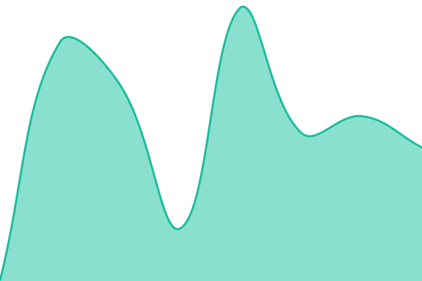

# [📈 Live Status](https://status.dustbowl.games): <!--live status--> **🟩 All systems operational**

This repository contains the open-source uptime monitor and status page for [DustBowl.Games](https://dustbowl.games/), powered by [Upptime](https://github.com/upptime/upptime).

With [Upptime](https://upptime.js.org), you can get your own unlimited and free uptime monitor and status page, powered entirely by a GitHub repository. We use [Issues](https://github.com/DustBowl-Games/status/issues) as incident reports, [Actions](https://github.com/DustBowl-Games/status/actions) as uptime monitors, and [Pages](https://status.dustbowl.games) for the status page.

<!--start: status pages-->
<!-- This summary is generated by Upptime (https://github.com/upptime/upptime) -->
<!-- Do not edit this manually, your changes will be overwritten -->
<!-- prettier-ignore -->
| URL | Status | History | Response Time | Uptime |
| --- | ------ | ------- | ------------- | ------ |
|  [DustBowl.Games (Public Web)](https://dustbowl.games) | 🟩 Up | [dust-bowl-games-public-web.yml](https://github.com/DustBowl-Games/status/commits/HEAD/history/dust-bowl-games-public-web.yml) | 

 336ms
     
 | 

<a href="https://status.dustbowl.games/history/dust-bowl-games-public-web">94.90%</a>
    

|  [Cloudflare Tunnel & Edge Gateway (db-rke2-lan)](https://vaultwarden.dustbowl.games/alive) | 🟩 Up | [cloudflare-tunnel-and-edge-gateway-db-rke2-lan.yml](https://github.com/DustBowl-Games/status/commits/HEAD/history/cloudflare-tunnel-and-edge-gateway-db-rke2-lan.yml) | 

 368ms
     
 | 

<a href="https://status.dustbowl.games/history/cloudflare-tunnel-and-edge-gateway-db-rke2-lan">100.00%</a>
    

|  [Vaultwarden (Encrypted Password Vault)](https://vaultwarden.dustbowl.games) | 🟩 Up | [vaultwarden-encrypted-password-vault.yml](https://github.com/DustBowl-Games/status/commits/HEAD/history/vaultwarden-encrypted-password-vault.yml) | 

 202ms
     
 | 

<a href="https://status.dustbowl.games/history/vaultwarden-encrypted-password-vault">100.00%</a>
    

|  [Knowledgebase & Support Docs](https://dustbowl.games/kb) | 🟩 Up | [knowledgebase-and-support-docs.yml](https://github.com/DustBowl-Games/status/commits/HEAD/history/knowledgebase-and-support-docs.yml) | 

 257ms
     
 | 

<a href="https://status.dustbowl.games/history/knowledgebase-and-support-docs">94.90%</a>
    

<!--end: status pages-->

[**Visit our status website →**](https://status.dustbowl.games)

## 📄 License

- Powered by: [Upptime](https://github.com/upptime/upptime)
- Code: [MIT](./LICENSE) © [Anand Chowdhary](https://anandchowdhary.com)
- Data in the `./history` directory: [Open Database License](https://opendatacommons.org/licenses/odbl/1-0/)
